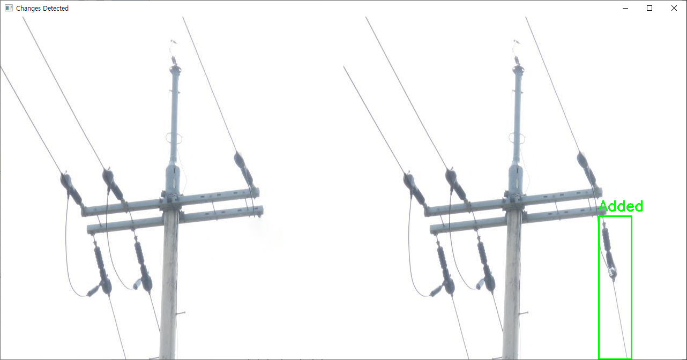
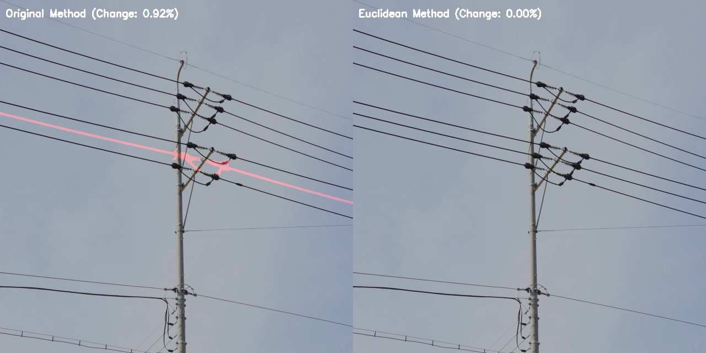

# Wire Detection & Change Analysis

[한국어](README.md) | **English**

**Power distribution infrastructure · YOLOv11l-seg + 2DCNN**

This research explores object segmentation and anomaly detection in images of power distribution infrastructure, including wires and utility poles. The repository brings together the associated KCI-indexed journal paper, experiment notebooks, and representative results.

[Full paper](https://www.kism.or.kr/file/memoir/14_8_7.pdf) · [DOI](https://doi.org/10.30693/SMJ.2025.14.8.60) · [KCI record](https://www.kci.go.kr/kciportal/ci/sereArticleSearch/ciSereArtiView.kci?sereArticleSearchBean.artiId=ART003234567) · [Key notebooks](#key-notebooks) · [Citation](#citation)

## Publication

### Research or Anomaly Detection Model for Distribution Grids Using Deep Learning-Based Object Detection

**Hun Jea Lee**, Jin Sung Kim, Se Hoon Jung, Chun Bo Shim<br>
*Smart Media Journal*, **14(8), 60–72**, August 2025

The paper studies an **anomaly detection model combining YOLOv11l-seg and a 2D CNN**. It uses segmentation annotations and data augmentation, and compares five object detection models for analyzing power distribution infrastructure.

| Dataset | Object annotations | YOLOv11l-seg mAP@50 |
|:---:|:---:|:---:|
| **4,475 images** | **56,797 objects · 3 classes** | **0.830** |

Dataset statistics are reported on page 63 of the paper; model performance is reported on page 68. The dataset contains **3,585 training**, **443 validation**, and **447 test** images across three classes: **Wire · Crossarm · Pole**. [Source: published paper](https://www.kism.or.kr/file/memoir/14_8_7.pdf)

## Representative Results



*An archived change detection example. The additional region in the right-hand image is marked as `Added`.*

<details>
<summary>View a comparison of image analysis methods</summary>



The change percentages shown in this image are outputs for this particular image pair. They do not represent accuracy across the dataset. Original file locations are documented in the [representative results notes](results/representative/README.md) (Korean).

</details>

## Model Comparison

The following results are reported on page 68 of the paper. The **YOLOv11l-seg** row highlights the model used in the proposed approach.

| Model | F1 | Precision | Recall | mAP@50 | mAP@50:95 |
|:---|---:|---:|---:|---:|---:|
| Mask R-CNN | 0.573 | 0.542 | 0.581 | 0.566 | 0.237 |
| ConvNeXt | 0.596 | 0.599 | 0.626 | 0.568 | 0.249 |
| YOLOv8l-seg | 0.828 | 0.865 | 0.826 | 0.830 | 0.457 |
| YOLOv9c-seg | 0.817 | 0.842 | 0.828 | 0.807 | 0.417 |
| **YOLOv11l-seg** | **0.820** | **0.864** | **0.810** | **0.830** | **0.449** |

YOLOv11l-seg and YOLOv8l-seg both achieve **0.830 mAP@50**; YOLOv8l-seg has higher F1 and mAP@50:95 scores. These are object detection model metrics, not accuracy measurements for the complete change and anomaly detection pipeline. [Source: paper, p. 68](https://www.kism.or.kr/file/memoir/14_8_7.pdf#page=9)

The table was checked against the values stored in the [model comparison notebook](notebooks/analysis/chart.ipynb). Training and evaluation were not rerun when preparing this public archive.

## Research Components

- **Object detection and segmentation:** model training and comparison using segmentation annotations and data augmentation.
- **Change and anomaly detection:** analysis of power distribution infrastructure using YOLOv11l-seg and a 2D CNN.
- **Result analysis:** image differences, change region annotations, and model comparison plots.

Technologies: **Python · PyTorch · Ultralytics · OpenCV · Detectron2 · MMDetection**

## Key Notebooks

| Topic | Notebook |
|:---|:---|
| Image comparison using a 2D CNN and YOLOv11 | [2DCNN + YOLOv11](notebooks/research/2DCNN%2BYOLOv11.ipynb) |
| YOLOv11 segmentation training and inference experiments | [YOLOv11](notebooks/experiments/YOLOv11.ipynb) |
| Change and anomaly detection experiments | [Anomaly detection](notebooks/research/모델%20이상%20탐지.ipynb) |
| Quantitative results and model comparison plots | [chart](notebooks/analysis/chart.ipynb) |

The [paper and code guide](docs/PAPER.md) (Korean) maps the comparison models to related notebooks.

<details>
<summary>Repository structure</summary>

```text
notebooks/
  research/             Change and anomaly detection
  experiments/          Model training and inference experiments
  analysis/             Comparison plots and image preprocessing
  legacy/               Early and reference experiments
src/sift/               Feature-based image comparison
results/representative/ Selected visual results
docs/                   Paper, environment, data, and file provenance
CITATION.cff            Paper citation metadata
CITATION.bib            BibTeX
```

</details>

## Running the Notebooks and Accessing Data

This repository is an **archive of research notebooks**. To run an experiment, update the data and model weight paths in the selected notebook and prepare the environment required by that model. Original code cells are preserved; saved outputs and execution counts have been cleared from the public copies.

Raw data, model weights, full training logs, and original notebook outputs are retained separately in a local archive. This public repository contains code, documentation, and representative results.

Supporting documentation is currently in Korean: [Environment and execution notes](docs/ENVIRONMENT.md) · [Data and model archive guide](docs/DATA_AND_MODELS.md) · [File provenance](docs/FILE_PROVENANCE.csv)

## Citation

The citation below preserves the paper's Korean bibliographic record.

> 이훈제, 김진성, 정세훈, 심춘보. (2025). 딥러닝 기반 객체 탐지를 활용한 배전공가 이상 탐지 모델 연구. *스마트미디어저널*, 14(8), 60–72. https://doi.org/10.30693/SMJ.2025.14.8.60

[BibTeX](CITATION.bib) · [CITATION.cff](CITATION.cff)

The paper is available through the publisher's official link. See the [paper notes](docs/PAPER.md#pdf-공개-범위) (Korean) for the scope of the PDF redistribution and code licensing review.
