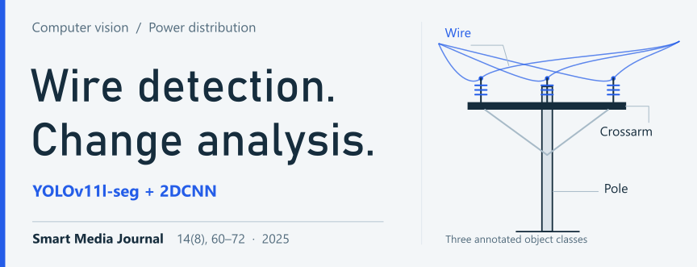
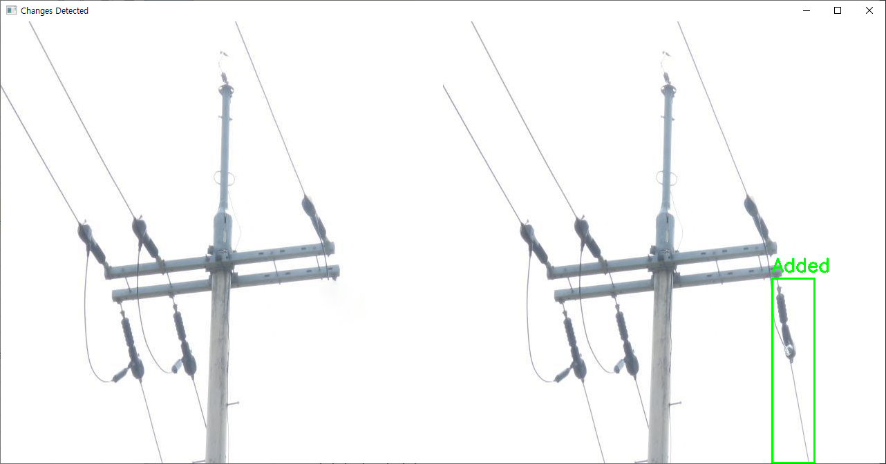
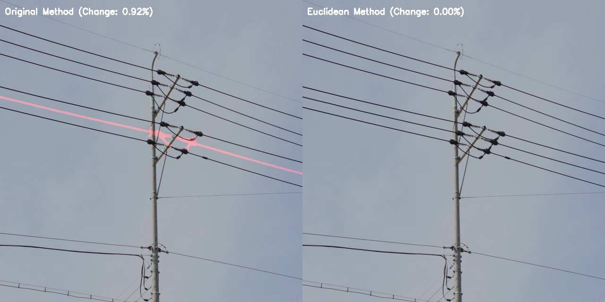
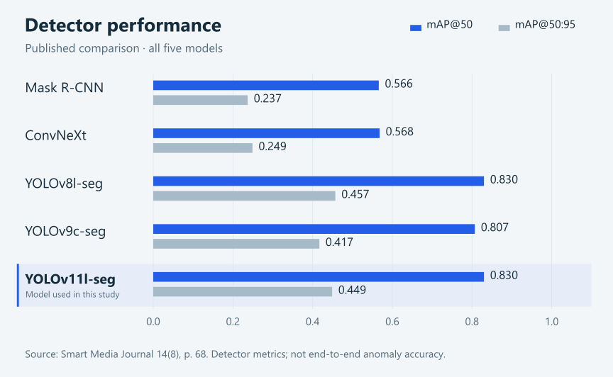

[English](README.md) · **한국어**



객체 분할과 영상 비교를 통해 배전설비의 구조적 변화와 이상을 탐지하는 연구입니다. **YOLOv11l-seg와 2DCNN**을 결합한 연구의 KCI 등재 논문, 실험 코드, 대표 결과를 정리했습니다.

**[논문 읽기 ↗](https://www.kism.or.kr/file/memoir/14_8_7.pdf)** &nbsp; · &nbsp; **[연구 결과](#대표-결과)** &nbsp; · &nbsp; **[코드 살펴보기](#주요-코드)**

## 대표 결과



보관된 변화 탐지 실험의 한 사례입니다. 오른쪽 영상에서 추가된 영역을 **Added**로 표시했습니다. 이 이미지와 논문 최종 체크포인트의 일대일 대응은 확인되지 않았습니다.

<details>
<summary>시각화 결과 더 보기</summary>



변화율은 해당 영상 쌍의 출력값이며, 전체 데이터셋의 정확도를 뜻하지 않습니다. [대표 결과 안내](results/README.md)에서 원본 위치를, [추가 시각화](results/figures/change_detection_result.jpg)에서 다른 결과를 확인할 수 있습니다.

</details>

## 논문 보고 성능

**4,475장** · **객체 레이블 56,797개** · **3개 클래스: Wire, Crossarm, Pole**

논문은 다섯 가지 객체 탐지 모델을 비교합니다. YOLOv11l-seg는 제안 연구에 사용된 검출 모델입니다.



YOLOv11l-seg와 YOLOv8l-seg의 **mAP@50은 0.830으로 같으며**, F1과 mAP@50:95는 YOLOv8l-seg가 더 높습니다. 이는 **객체 탐지 모델의 평가 지표**로, 변화·이상 탐지 전체 과정의 정확도를 뜻하지 않습니다. [논문 68쪽](https://www.kism.or.kr/file/memoir/14_8_7.pdf#page=9)

<details>
<summary>전체 성능 표와 데이터 분할</summary>

| 모델 | F1 | Precision | Recall | mAP@50 | mAP@50:95 |
|:---|---:|---:|---:|---:|---:|
| Mask R-CNN | 0.573 | 0.542 | 0.581 | 0.566 | 0.237 |
| ConvNeXt | 0.596 | 0.599 | 0.626 | 0.568 | 0.249 |
| YOLOv8l-seg | 0.828 | 0.865 | 0.826 | 0.830 | 0.457 |
| YOLOv9c-seg | 0.817 | 0.842 | 0.828 | 0.807 | 0.417 |
| **YOLOv11l-seg** | **0.820** | **0.864** | **0.810** | **0.830** | **0.449** |

데이터는 학습 **3,585장**, 검증 **443장**, 시험 **447장**으로 구성됩니다. 데이터 규모는 [논문 63쪽](https://www.kism.or.kr/file/memoir/14_8_7.pdf#page=4)에 보고된 값입니다.

표의 수치는 [모델 비교 노트북](notebooks/analysis/model_comparison.ipynb)과 대조했습니다. 공개 정리 과정에서 학습·평가를 다시 실행한 값은 아닙니다.

</details>

## 논문 소개

**딥러닝 기반 객체 탐지를 활용한 배전공가 이상 탐지 모델 연구**

**이훈제**, 김진성, 정세훈, 심춘보<br>
*스마트미디어저널* · **14(8), 60–72** · 2025년 8월 · KCI 등재

세그멘테이션 레이블링과 데이터 증강, 검출 모델 비교, 변화 분석을 통해 배전공가 영상을 분석한 연구입니다.

[학회 원문 PDF](https://www.kism.or.kr/file/memoir/14_8_7.pdf) · [DOI](https://doi.org/10.30693/SMJ.2025.14.8.60) · [KCI 논문정보](https://www.kci.go.kr/kciportal/ci/sereArticleSearch/ciSereArtiView.kci?sereArticleSearchBean.artiId=ART003234567) · [BibTeX](CITATION.bib)

## 주요 코드

관심 있는 연구 주제에서 시작할 수 있습니다.

| 살펴볼 내용 | 시작 노트북 |
|:---|:---|
| YOLOv11과 2DCNN을 이용한 영상 비교 | [변화 탐지](notebooks/change_detection/yolov11_2dcnn.ipynb) |
| 변화·이상 탐지 실험 | [이상 탐지](notebooks/change_detection/anomaly_detection.ipynb) |
| 논문에 보고된 모델별 성능 비교 | [결과 분석](notebooks/analysis/model_comparison.ipynb) |

**[전체 노트북](notebooks/README.md)** · **[특징점 비교·기준 모델](scripts/README.md)** · **[논문과 코드 대응](docs/PAPER.md)**

Python · PyTorch · Ultralytics · OpenCV · Detectron2 · MMDetection

<details>
<summary>저장소 구조</summary>

```text
notebooks/
  change_detection/       변화·이상 탐지와 비교 버전
  model_experiments/      YOLO·다른 검출 모델의 실험
  analysis/               모델 비교·영상 전처리
  legacy/                 초기·참고 실험
scripts/
  feature_matching/       SIFT·ORB 특징점 비교
  baselines/              YOLOv5 기반 변화 탐지
results/figures/          보관된 대표 결과 이미지
docs/                     논문·코드·환경·자료 안내
  assets/                 README 표지·논문 성능 그래프
CITATION.*                논문 인용 정보
```

[상세 코드 구성 안내](docs/CODE_MAP.md)

</details>

<details>
<summary>실험 실행 및 자료 안내</summary>

이 저장소는 **연구 노트북 아카이브**입니다. 실행하려면 선택한 노트북의 데이터·가중치 경로를 수정하고 해당 모델의 환경을 준비해야 합니다. 원본 코드 셀을 보존했으며, 공개 사본의 저장된 출력과 실행 번호는 제거했습니다.

SIFT·ORB와 YOLOv5 스크립트는 **현재 작업 디렉터리**에서 `Test*.jpg` 입력을 읽습니다. 필요한 이미지를 준비하거나 입력 경로를 수정해야 합니다. [스크립트 안내](scripts/README.md)

원본 데이터, 모델 가중치, 전체 학습 로그와 원본 노트북 출력은 로컬 아카이브에 별도로 보관합니다. 공개 저장소에는 코드·문서·대표 결과를 포함했습니다. 표지는 일러스트이며, 성능 그래프는 논문 보고값을 다시 시각화했습니다.

[환경 및 실행 안내](docs/ENVIRONMENT.md) · [데이터·모델 보관 안내](docs/DATA_AND_MODELS.md) · [원본 파일 대응표](docs/FILE_PROVENANCE.csv)

</details>

## 인용

> 이훈제, 김진성, 정세훈, 심춘보. (2025). 딥러닝 기반 객체 탐지를 활용한 배전공가 이상 탐지 모델 연구. *스마트미디어저널*, 14(8), 60–72. https://doi.org/10.30693/SMJ.2025.14.8.60

[BibTeX](CITATION.bib) · [CITATION.cff](CITATION.cff) · [논문 공개 범위와 라이선스 안내](docs/PAPER.md#pdf-공개-범위)
