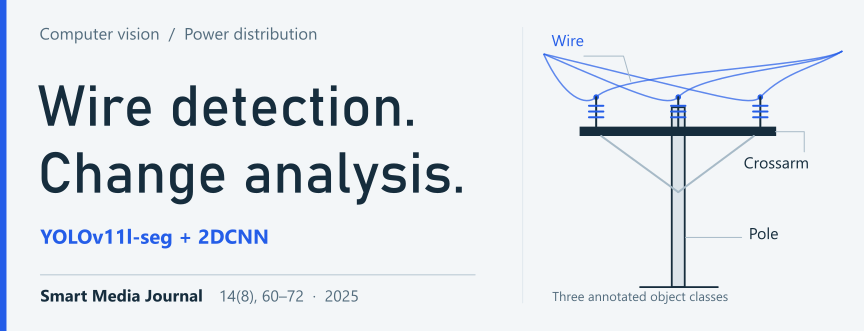
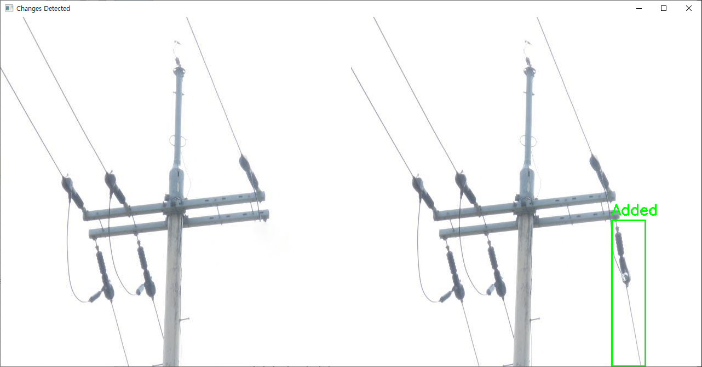
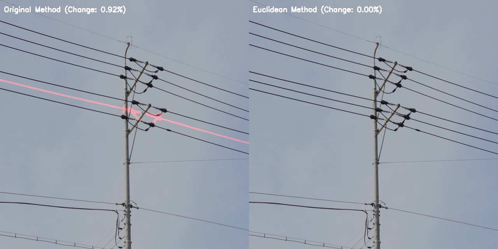
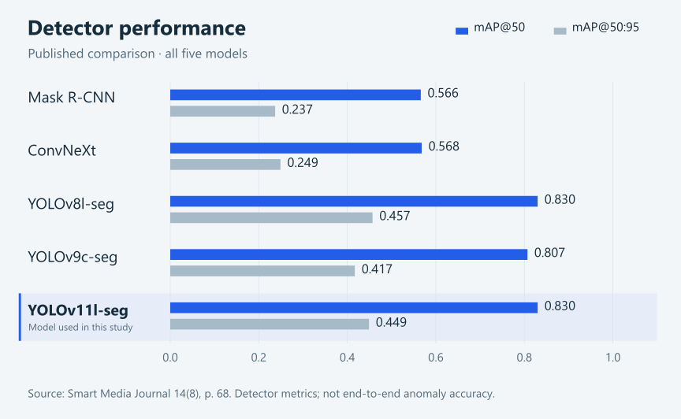

**English** · [한국어](README.ko.md)



Detecting structural changes in power distribution infrastructure through object segmentation and image comparison. This research combines **YOLOv11l-seg and a 2D CNN**, with a KCI-indexed journal publication and archived experiments.

**[Read the paper ↗](https://www.kism.or.kr/file/memoir/14_8_7.pdf)** &nbsp; · &nbsp; **[View results](#representative-result)** &nbsp; · &nbsp; **[Explore code](#explore-the-code)**

## Representative result



An archived change detection example: the additional region in the right-hand image is marked **Added**. This visual illustrates an individual experiment; its correspondence to the paper's final checkpoint has not been established.

<details>
<summary>More visual results</summary>



The change percentages describe this image pair, not dataset-level accuracy. See the [result notes](results/README.md) for original file locations and the [additional visualization](results/figures/change_detection_result.jpg).

</details>

## Reported performance

**4,475 images** · **56,797 annotated objects** · **3 classes: Wire, Crossarm, Pole**

The paper compares five object detectors. YOLOv11l-seg is the detector used in the proposed approach.



YOLOv11l-seg and YOLOv8l-seg tie at **0.830 mAP@50**; YOLOv8l-seg has higher F1 and mAP@50:95. These are **detector metrics**, not end-to-end anomaly detection accuracy. [Paper, p. 68](https://www.kism.or.kr/file/memoir/14_8_7.pdf#page=9)

<details>
<summary>Full evaluation table and dataset split</summary>

| Model | F1 | Precision | Recall | mAP@50 | mAP@50:95 |
|:---|---:|---:|---:|---:|---:|
| Mask R-CNN | 0.573 | 0.542 | 0.581 | 0.566 | 0.237 |
| ConvNeXt | 0.596 | 0.599 | 0.626 | 0.568 | 0.249 |
| YOLOv8l-seg | 0.828 | 0.865 | 0.826 | 0.830 | 0.457 |
| YOLOv9c-seg | 0.817 | 0.842 | 0.828 | 0.807 | 0.417 |
| **YOLOv11l-seg** | **0.820** | **0.864** | **0.810** | **0.830** | **0.449** |

The dataset contains **3,585 training**, **443 validation**, and **447 test** images. Dataset counts come from [page 63 of the paper](https://www.kism.or.kr/file/memoir/14_8_7.pdf#page=4).

The metrics were checked against the [model comparison notebook](notebooks/analysis/model_comparison.ipynb). Training and evaluation were not rerun when preparing this public archive.

</details>

## Publication

**Research or Anomaly Detection Model for Distribution Grids Using Deep Learning-Based Object Detection**

**Hun Jea Lee**, Jin Sung Kim, Se Hoon Jung, Chun Bo Shim<br>
*Smart Media Journal* · **14(8), 60–72** · August 2025 · KCI indexed

The study combines segmentation annotations, data augmentation, detector comparison, and change analysis for power distribution infrastructure. The English title above follows the published bibliographic record.

[Publisher PDF](https://www.kism.or.kr/file/memoir/14_8_7.pdf) · [DOI](https://doi.org/10.30693/SMJ.2025.14.8.60) · [KCI record](https://www.kci.go.kr/kciportal/ci/sereArticleSearch/ciSereArtiView.kci?sereArticleSearchBean.artiId=ART003234567) · [BibTeX](CITATION.bib)

## Explore the code

Start with the research question that interests you:

| Focus | Entry point |
|:---|:---|
| Compare images using YOLOv11 and a 2D CNN | [Change detection notebook](notebooks/change_detection/yolov11_2dcnn.ipynb) |
| Examine change and anomaly detection experiments | [Anomaly detection notebook](notebooks/change_detection/anomaly_detection.ipynb) |
| Inspect the reported model comparison | [Analysis notebook](notebooks/analysis/model_comparison.ipynb) |

**[All notebooks](notebooks/README.md)** · **[Feature matching & baselines](scripts/README.md)** · **[Paper-to-code guide](docs/PAPER.md)**

Python · PyTorch · Ultralytics · OpenCV · Detectron2 · MMDetection

<details>
<summary>Repository map</summary>

```text
notebooks/
  change_detection/       Change detection and comparison variants
  model_experiments/      YOLO and other detector experiments
  analysis/               Model comparison and image preprocessing
  legacy/                 Early and reference experiments
scripts/
  feature_matching/       SIFT and ORB feature matching
  baselines/              YOLOv5-based change detection
results/figures/          Original representative result images
docs/                     Paper, code, environment, and archive notes
  assets/                 README cover and published-metrics chart
CITATION.*                Paper citation metadata
```

[Detailed code map](docs/CODE_MAP.md) (Korean)

</details>

<details>
<summary>Running experiments and accessing data</summary>

This repository is an **archive of research notebooks**. To run an experiment, update the data and model-weight paths in the selected notebook and prepare the environment required by that model. Original code cells are preserved; saved outputs and execution counts have been cleared from the public copies.

The standalone SIFT/ORB and YOLOv5 scripts read `Test*.jpg` inputs from the **current working directory**. Prepare their inputs or adjust the paths before running them; see the [script guide](scripts/README.md).

Raw data, model weights, full training logs, and original notebook outputs remain in a separate local archive. The public repository contains code, documentation, and representative results. The cover is an illustration; the performance chart is redrawn from published values.

Supporting documentation is in Korean: [Environment notes](docs/ENVIRONMENT.md) · [Data and model archive](docs/DATA_AND_MODELS.md) · [File provenance](docs/FILE_PROVENANCE.csv).

</details>

## Citation

> 이훈제, 김진성, 정세훈, 심춘보. (2025). 딥러닝 기반 객체 탐지를 활용한 배전공가 이상 탐지 모델 연구. *스마트미디어저널*, 14(8), 60–72. https://doi.org/10.30693/SMJ.2025.14.8.60

[BibTeX](CITATION.bib) · [CITATION.cff](CITATION.cff) · [Paper access and licensing notes](docs/PAPER.md#pdf-공개-범위)
